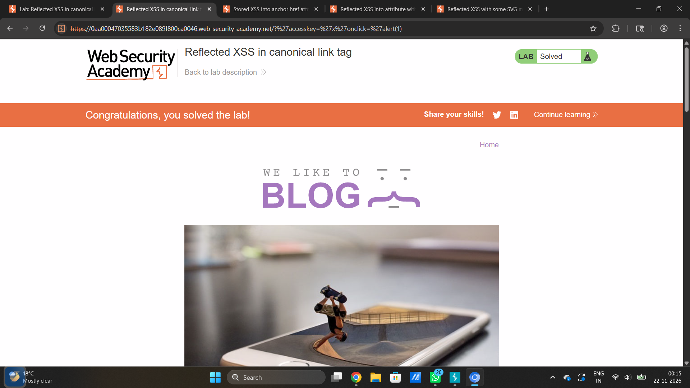

# Lab 12 — Reflected XSS in canonical link tag

**Category:** Cross-Site Scripting (XSS)
**Difficulty:** Practitioner
**Reference:** https://portswigger.net/web-security/cross-site-scripting/contexts

## Objective
Reflected input lands inside a `<link rel="canonical">` tag in the page head, in an environment where angle brackets are blocked. Exploit this using the Angular-free technique of injecting a new attribute.

## Vulnerability
The app reflects the full request URL (used to build a canonical link) into `<link rel="canonical" href="...YOUR INPUT...">`, filtering `<` and `>` but not other characters.

## Steps to Reproduce
1. Confirm the reflection occurs inside the `href` attribute of the canonical `<link>` tag in `<head>`.
2. Since the lab's filter blocks angle brackets, break out of the `href` attribute only (no new tag needed) and add a new attribute/event that executes on load, such as reflecting via the URL path and relying on a redirect/onload-style technique as guided by the lab, or simply closing the attribute and injecting `onload`/`autofocus`+`onfocus` style vectors where the parser allows.

## Payload(s) Used
```
'accesskey='x'onclick='alert(1)
```

## Explanation
By closing the `href` value with a single quote and adding `accesskey`/`onclick` (or similar) attributes to the same `<link>` tag, a user-interaction-triggered event handler is planted directly on an element that would otherwise be invisible metadata, giving the attacker script execution without ever needing a literal angle bracket.

## Screenshots



## Remediation
Encode all attribute-breaking characters (quotes, as well as angle brackets) wherever user input is reflected into any tag, including head metadata elements, and apply CSP to block inline event handlers.

---
*Lab solved on PortSwigger Web Security Academy. Writeup by Miley.*
