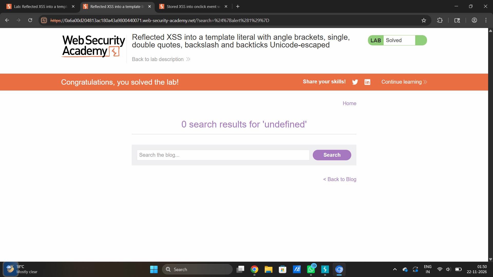

# Lab 13 — Reflected XSS into a template literal with angle brackets, single, double quotes, backslash and backticks Unicode-escaped

**Category:** Cross-Site Scripting (XSS)
**Difficulty:** Practitioner
**Reference:** https://portswigger.net/web-security/cross-site-scripting/contexts

## Objective
Input is reflected inside a JavaScript template literal (backticks). All the 'obvious' escape characters are Unicode-encoded by the filter, but `${...}` template expression syntax is not blocked.

## Vulnerability
The app builds something like `` var message = `Search results for: ${SEARCH_TERM}`; `` and escapes quotes/backticks/backslashes to their `\uXXXX` forms, but doesn't account for JS template-literal expression interpolation itself being dangerous.

## Steps to Reproduce
1. Confirm the reflection is inside a backtick-delimited template literal.
2. Since backticks/quotes are escaped, use `${...}` syntax directly (which requires no backtick/quote characters at all) to inject and execute arbitrary JS inside the template expression.

## Payload(s) Used
```
${alert(1)}
```

## Explanation
A JS template literal evaluates anything inside `${ }` as a live JavaScript expression at runtime. Because this payload uses none of the characters the filter escapes (no quotes, backticks, or backslashes), it passes straight through untouched, and the browser executes `alert(1)` as soon as the template literal is evaluated.

## Screenshots



## Remediation
Never interpolate untrusted input directly into a JS template literal; if dynamic text must be shown, insert it via safe DOM text APIs after the script has already built the literal, not by splicing user data into the source of the literal itself.

---
*Lab solved on PortSwigger Web Security Academy. Writeup by Miley.*
