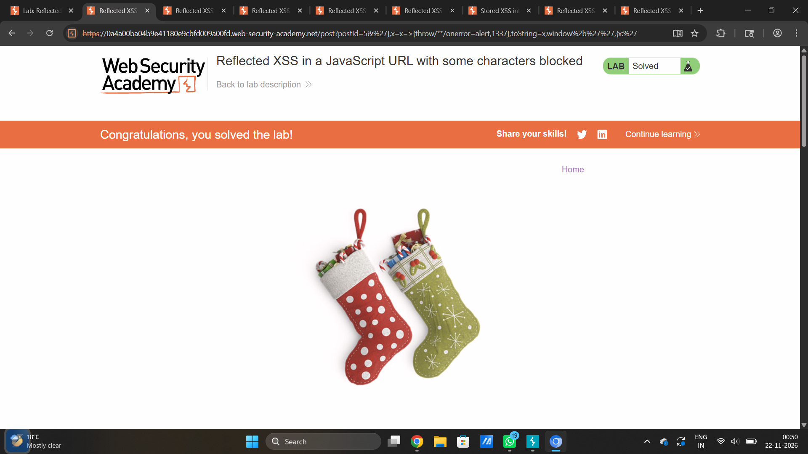

# Lab 18 — Reflected XSS in a JavaScript URL with some characters blocked

**Category:** Cross-Site Scripting (XSS)
**Difficulty:** Expert
**Reference:** https://portswigger.net/web-security/cross-site-scripting/contexts

## Objective
A blog post's URL (`postId` and related query parameters) is reflected into a JavaScript execution context, but a filter blocks a number of characters commonly used in XSS payloads, including ones needed for a normal function call like `alert(1)`. Achieve script execution anyway.

## Vulnerability
The reflected value is injected into JavaScript source that gets executed as part of the page's own logic. The filter blocks enough characters/sequences that straightforward payloads such as `alert(1)` or `'-alert(1)-'` get stripped or rejected, forcing a payload that avoids the blocked characters/patterns entirely.

## Steps to Reproduce
1. Fuzz the query parameter with common XSS characters/payloads to map out which characters or keywords the filter strips or blocks.
2. Realize direct function-call syntax is restricted, so `alert(1)` (and similar direct calls) can't be used as-is.
3. Build a payload that triggers `alert` *indirectly* — by assigning it as a `window.onerror` handler and then forcing an error to be thrown, using JavaScript's implicit type coercion (string concatenation with `window`) to call a custom `toString()` that throws.

## Payload(s) Used
```
'};x=x=>{throw/**/onerror=alert,1337},toString=x,window+''+{x:'
```

## Explanation
This payload never directly calls `alert(1337)` with parentheses the filter can flag. Instead:
- `onerror=alert` sets the global `window.onerror` handler to the `alert` function reference (no call, just an assignment).
- `x=x=>{throw/**/onerror=alert,1337}` defines an arrow function that, when invoked, throws the value `1337` (the comma operator lets both the `onerror=alert` assignment and the `throw 1337` happen in one expression). `/**/` is used in place of a space, since whitespace may also be filtered.
- `toString=x` overrides the object's own `toString` method with that throwing function.
- `window+''` forces JavaScript to coerce `window` to a string for concatenation, which calls `.toString()` on it — triggering the overridden `toString`, which throws `1337`.
- Because `window.onerror` was already set to `alert`, the thrown exception is caught by the global error handler and passed to `alert()`, popping the dialog — all without the payload itself containing a direct, parenthesized call to `alert(...)`.

## Screenshots



## Remediation
Character/keyword blocklist filters for XSS are fundamentally unreliable because JavaScript offers many equivalent ways to achieve the same effect (implicit coercion, operator overloading, event handlers) without using any specific "dangerous" token. The real fix is to never reflect user input into an executable JavaScript context at all; if dynamic values must reach client-side script, pass them through a safely JSON-encoded data attribute instead.

---
*Lab solved on PortSwigger Web Security Academy. Writeup by Miley.*
