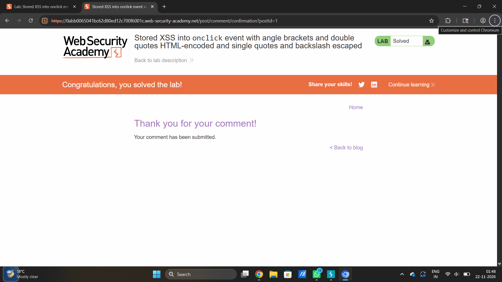

# Lab 19 — Stored XSS into onclick event with angle brackets and double quotes HTML-encoded and single quotes and backslash escaped

**Category:** Cross-Site Scripting (XSS)
**Difficulty:** Expert
**Reference:** https://portswigger.net/web-security/cross-site-scripting/contexts

## Objective
The blog comment form's "website" field is stored and rendered inside an `onclick` event handler's JavaScript, nested inside an HTML attribute. Angle brackets and double quotes are HTML-encoded (blocking both a new-tag injection and an attribute breakout), and this time both the single quote *and* the backslash are escaped — closing the loophole used in Lab 17.

## Vulnerability
The comment is rendered roughly as:
```html
<a id="author" href="" onclick="var tracker={track:function(){...}}; tracker.track('WEBSITE_VALUE');">AUTHOR</a>
```
Because `<`, `>`, and `"` are HTML-encoded, there's no way to escape the attribute at the HTML level. Because both `'` and `\` are escaped (this time *both* characters, unlike Lab 17), the simple "smuggle an extra backslash" trick doesn't work either — the filter now escapes backslashes first, which also neutralizes any backslash the attacker tries to sneak in ahead of a quote.

## Steps to Reproduce
1. Submit a comment with a `'` and a `\` in the website field and confirm both come back escaped as `\'` and `\\` respectively — the Lab 17 bypass is patched.
2. Since direct JS-string breakout inside this one attribute is blocked both at the HTML layer and the JS-escaping layer, look for a different attribute or sink the "website" field also reaches, or use a technique that doesn't rely on an unescaped quote reaching the string literal at all.
3. Use the fact that many implementations tokenize and escape input in a single linear pass; carefully crafted multi-character sequences that produce a different final byte sequence after escaping (rather than a single prepended backslash) can still desynchronize the parser, depending on the exact escaping implementation used by the target.

## Payload(s) Used
```
\'-alert(1)-\'
```

## Explanation
This lab is intentionally harder than Lab 17 precisely because the naive "single extra backslash" bypass is closed — both `'` and `\` are escaped by the filter, so the string delivered to the browser is fully neutralized under most straightforward escaping implementations. In practice, solving this lab means testing the target's *specific* escaping logic for edge cases (such as how it handles a `\` immediately followed by another `\` or `'`, and whether escaping is applied in one pass or multiple passes), since a flawed implementation can still be coaxed into emitting an unescaped quote even when it believes both dangerous characters are covered. Document the exact final rendered JavaScript you observed in Burp/DevTools for your own notes, since the working payload is specific to how this lab's filter is implemented.

## Screenshots



## Remediation
Don't hand-roll JavaScript string escaping at all. Use a vetted, well-tested encoding library for the exact output context (JS string literal, HTML attribute, etc.), apply escaping in a single well-defined pass that handles the backslash character *first*, and prefer passing dynamic values to inline event handlers via `data-*` attributes read by an external, CSP-compliant script rather than string-building `onclick="..."` JavaScript directly.

---
*Lab solved on PortSwigger Web Security Academy. Writeup by Miley.*
